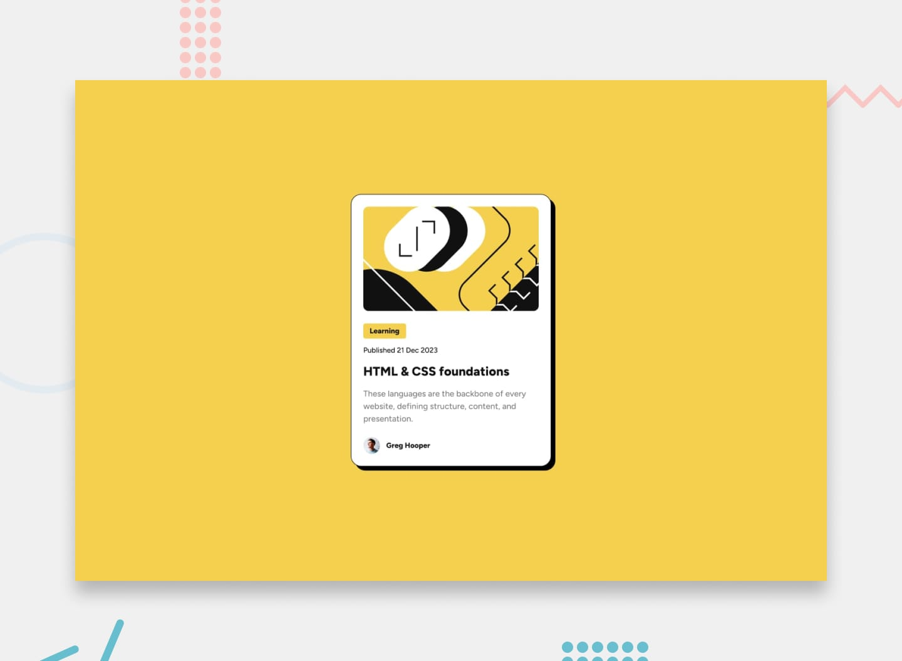

# Frontend Mentor - Blog preview card solution

This is a solution to the [Blog preview card challenge on Frontend Mentor](https://frontendmentor.io). Frontend Mentor challenges help you improve your coding skills by building realistic projects.

## Table of contents

- [Overview](#overview)
- [The challenge](#the-challenge)
- [Screenshot](#screenshot)
- [Links](#links)
- [My process](#my-process)
- [Built with](#built-with)
- [What I learned](#what-i-learned)
- [Continued development](#continued-development)
- [Author](#author)

## Overview

### The challenge

Users should be able to:

- View the optimal layout depending on their device's screen size (mobile and desktop).
- See interactive `:hover`, `:focus`, and `:focus-visible` states on the card title link.

### Screenshot


*(Tip: Replace `./preview.jpg` with a screenshot of your own rendered project if required!)*

### Links

## My process

### Built with

- Semantic HTML5 markup (`<main>`, `<section>`, `<article>`, `<footer>`)
- CSS3 custom styling with HSL colors and Flexbox
- Mobile-first / responsive media queries (`@media screen and (max-width: 400px)`)
- **Figtree** font family (`500` and `800` weights)

### What I learned

Building this card component reinforced clean semantic HTML structuring and precise CSS layout control:

- **Semantic Card Architecture:** Structuring the card cleanly with `<section class="card">` and nested `<article>` blocks for content and author profile details.
- **Offset Shadow & Borders:** Combining a crisp `1px solid hsl(0, 0%, 7%)` border with a solid offset `box-shadow: 8px 8px hsl(0, 0%, 7%)` and `border-radius: 20px` to match the design specs.
- **Interactive States & Accessibility:** Styling smooth color transitions (`transition: color 0.2s ease`) across `:hover`, `:focus`, and `:focus-visible` states:

```css
.card-title a:hover,
.card-title a:focus,
.card-title a:focus-visible {
color: hsl(47, 88%, 63%);
outline: none;
}
```

- **Responsive Typography:** Adjusting card `max-width` (`384px` to `327px`) and scaling down font sizes cleanly inside a `max-width: 400px` media query for smaller screens.

### Continued development

In future frontend projects, I plan to focus on:

- Using relative units (`rem` and `em`) alongside `px` for scalable typography and spacing.
- Keeping keyboard focus indicators accessible with custom visible focus rings when removing default browser outlines.

## Author

- **Name:** Cedrick Mbuyamba
- **GitHub:** [@cedrickmmk](https://github.com)
- **Frontend Mentor:** [@cedrickmmk](https://frontendmentor.io)

### How did using Figma designs as references affect your coding process?
Using the Figma designs gave me an exact visual blueprint before writing any code. Instead of guessing spacing or colors, I organized my semantic HTML structure first (<main>, <section>, <article>) and translated the exact HSL color values, Figtree and Outfit fonts, and layout dimensions straight into CSS.
### What challenges did you encounter when aligning your code with the design specifications?
Matching small visual details—such as the solid offset box-shadow: 8px 8px hsl(0, 0%, 7%), exact border-radius (20px on the card, 10px on the image), and :hover/:focus-visible color transitions—required careful tweaking. Adjusting max-width (384px down to 327px) and font sizes inside a max-width: 400px media query so the card stayed responsive across mobile and desktop screens was also a key challenge.
### How can the feedback and community resources on Frontend Mentor help you improve as a developer?
Community feedback helps catch improvements that aren't obvious visually—such as using relative units (rem) instead of px for accessibility, keeping visible keyboard focus indicators, and writing cleaner CSS. Reviewing how other developers structured their solutions also introduces better patterns for future projects.

